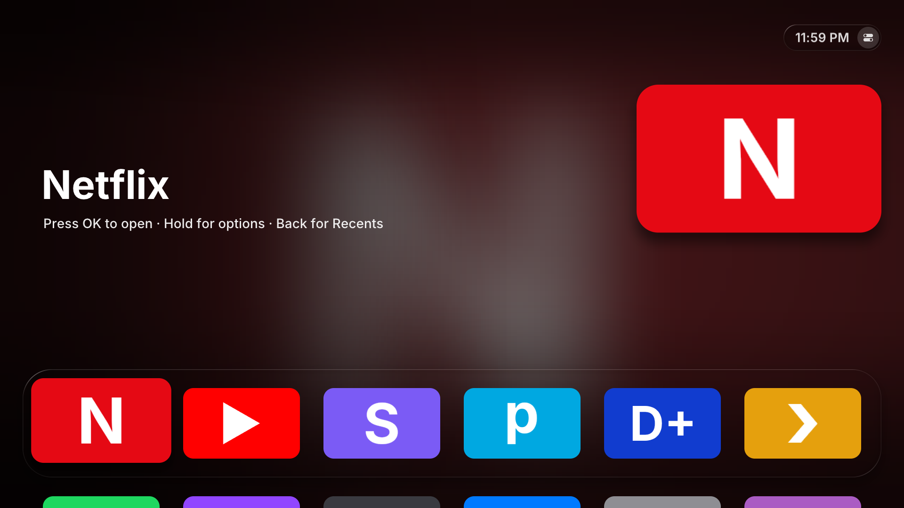
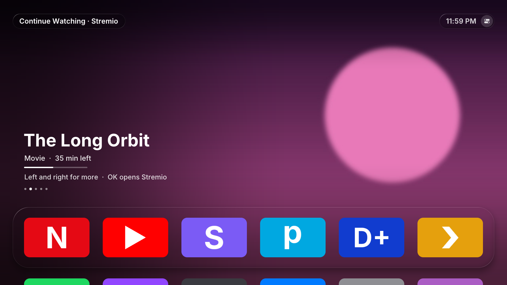

# Home+

A tvOS-style home screen for rooted LG webOS TVs, in a Liquid Glass look, with Stremio and Trakt Continue Watching.





*Screenshots use placeholder apps and shows.*

> **Not affiliated with LG, Apple, Stremio or Trakt.** Home+ is an independent project. tvOS and Liquid Glass are Apple's names for Apple's designs; Home+ only borrows the look. It runs on **rooted** TVs and uses Stremio's and Trakt's web APIs unofficially. Use it at your own risk.

## What it does

- **Top Shelf:** focus an app in the top row and the screen fills with its artwork, or with a glow taken from its icon.
- **Liquid Glass:** the dock, clock, buttons and menus bend the light at their edges and blur only what sits behind text. Focused tiles lift, sway and catch a moving light. The Magic Remote pointer steers that light.
- **Motion and sound:** everything moves on springs, and menus grow out of the button that opened them. A soft tick plays when focus moves; **Settings → Sounds** turns it off.
- **Continue Watching:** your Stremio library and Trakt progress in one row, newest first. Focus Stremio in the top row, then press **Up** to browse it.
- **Recents:** an App Switcher for open apps, most recent first. Open them, close them one by one, or close them all.
- **Your layout:** hold **OK** on an app to move it, move it to the front or hide it. Hidden apps collect in a "Hidden" tile at the end.
- **Home button:** optionally, the Home button opens Home+ instead of LG's home screen.
- **OLED care:** the picture drifts by a pixel every minute, and an idle Home+ dims, then goes black.
- **Light on the TV:** a native app (C, SDL2, OpenGL ES 2) that draws nothing while nothing moves. It shares the GPU happily with PicCap and HyperHDR.

## Requirements

- A **rooted** LG TV running webOS, with the **[Homebrew Channel](https://github.com/webosbrew/webos-homebrew-channel)** installed.
- **Tested on:** LG C3 (OLED), webOS 23.20.59. Other recent webOS TVs may well work, but haven't been tried. If you try one, please open an issue saying how it went.
- **Optional:**
  - a [Stremio](https://www.stremio.com) account and the Stremio app, for Continue Watching;
  - a [Trakt](https://trakt.tv) account;
  - [lginputhook](https://github.com/Simon34545/lginputhook), for a Home button without a flash (see [Home button](#home-button)).

## Install

1. Download `com.github.pmiraka.homeplus_<version>_all.ipk` from [Releases](../../releases).
2. Install it with [webOS Dev Manager](https://github.com/webosbrew/dev-manager-desktop) (Apps → Install), or with `ares-install`.
3. Open **Home+** from the app list.

**What the first start does:** Home+ asks the Homebrew Channel for the root access its background service needs, restarts that service and installs its own boot script, so it's ready every time the TV starts. You'll see "Setting Up Home+" for a few seconds. Then Home+ asks whether the Home button should open it. You can change that answer any time in Settings.

If something stops it, the screen says what and offers **Try Again**:

| Screen | What it means |
|---|---|
| Homebrew Channel Needed | The Homebrew Channel isn't installed, or isn't running as root. |
| Couldn't Get Permission | The Homebrew Channel refused to give Home+ root access. Check that the TV is rooted and the Homebrew Channel is up to date. |
| Home+ Couldn't Start | Home+'s background service didn't answer. Restarting the TV usually fixes this. |

Updates install the same way. An update resets the service's root access, and Home+ sets it up again the next time it starts.

## Using Home+

| Key | What it does |
|---|---|
| Arrows, **OK** | Move and open. Hold **OK** for an app's options. |
| **Back** | Closes a menu, steps out of Continue Watching or the top buttons, then jumps to the first app. On the first app it opens Recents. It never leaves Home+. |
| **Red** | Recents |
| **Green** | Settings |
| **Yellow** | The focused app's options |
| **Blue** | Move the focused app (press again when it's in place) |

**Magic Remote pointer:** point at anything and click. Pressing an arrow hands control back to the keys: then OK presses what the keys focused, wherever the cursor happens to be. Moving the pointer clearly takes over again.

From the top row, press **Up** to reach the round **Recents** and **Settings** buttons next to the clock. On the Stremio tile, Up goes into Continue Watching first. The remote's own **Settings** and **Input** keys open LG's menus; apps never receive them.

**Settings** opens LG's settings apps and has switches for the Home button and sounds, plus **Accessibility** (Reduce Motion, Reduce Transparency). It also has the Trakt sign-in and **Remove Home+**.

## Continue Watching

### Stremio

Home+ has no on-screen sign-in yet. Sign in once over SSH (Homebrew Channel → Settings → SSH Server):

```sh
luna-send -n 1 luna://com.github.pmiraka.homeplus.service/stremioLogin '{"email":"you@example.com","password":"…"}'
```

The password goes only to `api.strem.io`. The TV keeps only the session key that Stremio returns.

Pressing **OK** on a card opens Stremio. Stremio's LG app can't jump to a specific title from outside, so a notification names the title, ready to pick from Stremio's own Continue Watching.

### Trakt

Trakt's paused playback joins the same row. Stremio also reports to Trakt, so a title can appear in both; Home+ shows it once. Trakt doesn't record which app played something, so its titles open in Stremio.

Trakt needs an API app of your own (it's free):
1. Create one at <https://trakt.tv/oauth/applications/new>, with `urn:ietf:wg:oauth:2.0:oob` as the redirect URI.
2. Give Home+ its Client ID and Secret, over SSH:
   ```sh
   luna-send -n 1 luna://com.github.pmiraka.homeplus.service/traktSetup '{"clientId":"…","clientSecret":"…"}'
   ```
3. On the TV, go to **Settings → Connect Trakt**, then enter the code it shows at <https://trakt.tv/activate>.

## Home button

With **Settings → Home Button: Opens Home+**, Home+ watches for LG's home screen and opens itself instead. LG's home screen shows for a moment first.

To remove that flash, use lginputhook (1.5.1 or later, from the Homebrew Channel). It catches the Home button before LG's home screen starts. In the LG Input Hook app, add a keybind for button **773**, choose **Launch App** and pick **Home+**. Or put this in `/home/root/.config/lginputhook/keybinds.json`:

```json
{"773": {"action": "launch", "id": "com.github.pmiraka.homeplus"}}
```

On TVs where LG's home screen is a web app (not the C3), Settings also offers **Home Button: No Flash**. In that mode, Home+ replaces LG's home page in memory while it runs; nothing on disk changes.

## OLED protection

A home screen keeps bright, static things in place for hours, so Home+ adds to LG's own Pixel Refresher and Screen Shift:
- **Pixel orbit:** every minute the whole picture moves by one pixel along a slow path, never more than 4 px from centre.
- **Idle dimming:** after 2 minutes without input, everything but the focused tile dims.
- **Black screen:** after 10 minutes it fades to black and stops drawing. The first key press only wakes it.

To change the timings (in minutes), run this on the TV:

```sh
T=$(cat /media/developer/apps/usr/palm/applications/com.github.pmiraka.homeplus/api-token)
curl -s -H "X-Homeplus-Token: $T" -H 'Content-Type: application/json' -d '{"dimMinutes":5,"offMinutes":20}' http://127.0.0.1:47823/api/prefs
```

## Removing Home+

**Settings → Remove Home+** undoes everything Home+ set up, then uninstalls it:
- it turns off the Home button takeover;
- it deletes its boot script and settings;
- it deletes its Stremio and Trakt sign-ins;
- it removes its lginputhook keybinds (your others stay);
- it deletes the root access files the Homebrew Channel created.

**If Home+ won't open,** do the same by hand over SSH:

```sh
rm -f /var/lib/webosbrew/init.d/50-homeplus
rm -rf /var/lib/homeplus
luna-send -n 1 luna://com.webos.appInstallService/dev/remove '{"id":"com.github.pmiraka.homeplus"}'
```

If you added the lginputhook keybind, delete it in the LG Input Hook app. If the TV ever has trouble booting, the Homebrew Channel's failsafe skips boot scripts after a crash during start-up, so the TV comes back without Home+'s.

## Troubleshooting

- **Home+ is stuck on a setup screen:** press Try Again. If that doesn't help, these logs on the TV say why:
  - `/tmp/homeplus-service.log`: the service.
  - `homeplus-native.log`: the launcher's own log, inside its app sandbox. Find it with `find / -name homeplus-native.log`.
  - `/tmp/homeplus-boot.log`: the boot script.
- **The Home button still opens LG's home screen:** check **Settings → Home Button**. If you use lginputhook, restart the TV after changing its keybinds.
- **No Continue Watching:** sign in to Stremio (above), and make sure the Stremio tile is in the top row.

## Privacy and security

- **What Home+ connects to:** nothing but Stremio's and Trakt's APIs, and only if you sign in. Stremio artwork comes from `images.metahub.space`.
- **What's stored:** sign-ins, your layout and preferences, in `/var/lib/homeplus/config.json` (readable only by root).
- **The local API:** the service runs as root and answers only on `127.0.0.1`. Every request needs a token the service writes into Home+'s app folder, and requests from web pages and other hosts are refused.

## Building from source

The launcher is built with the webOS TV toolchain ([openlgtv/buildroot-nc4](https://github.com/openlgtv/buildroot-nc4)). The easiest route is Docker, which works on Linux and macOS, Intel or Apple Silicon:

```sh
tools/docker-build.sh                  # -> dist/com.github.pmiraka.homeplus_<version>_all.ipk
tools/install.sh <tv-ip>               # copy it to the TV over SSH, install, set up root, open it
```

Without Docker, unpack the toolchain, run its `relocate-sdk.sh`, then `WEBOS_SDK=/path/to/arm-webos-linux-gnueabi_sdk-buildroot tools/build-release.sh`. `tools/native-preview/run.sh` renders screenshots on a Linux desktop. It runs the real service against a stand-in for webOS, and the shots land in `preview/`.

Every push is built by GitHub Actions. Pushing a `v*` tag publishes a release with the `.ipk` attached.

## How it works

One package, `com.github.pmiraka.homeplus`, holds three things:
- **The launcher** (`native/`): C with SDL2 and OpenGL ES 2, using the TV's own libraries. Our renderer (`native/src/render.c`) draws the glass, shapes and shadows with shaders. A frame is a few dozen quads, and glass works on a half-resolution copy of the screen. Animations are springs, and nothing is redrawn while nothing moves.
- **The service** (`service/`): a Node.js webOS service that runs as root once the Homebrew Channel elevates it. It lists, opens and closes apps and serves their icons. It also talks to Stremio and Trakt, and handles the Home button.
- **The boot script** (`init.d/`): makes the Homebrew Channel re-elevate and start the service at every boot.

The launcher talks to the service over a local HTTP API on `127.0.0.1:47823`. It uses the webOS luna bus only to start the service and to ask the Homebrew Channel for root.

| Endpoint | What it does |
|---|---|
| `GET /api/status` | Version, whether the service is root, setup state (no token needed) |
| `GET /api/apps` | App list |
| `POST /api/launch` | Open an app |
| `GET` / `POST /api/layout` | Tile order and hidden apps |
| `GET /api/continue` | Continue Watching from Stremio and Trakt |
| `GET /api/system` | LG's settings apps |
| `GET /api/running`, `POST /api/close` | Recents, and closing apps |
| `GET` / `POST /api/home` | Home button mode |
| `GET` / `POST /api/prefs` | `sounds`, `dimMinutes`, `offMinutes`, `reduceMotion`, `reduceTransparency` |
| `POST /api/uninstall` | Remove Home+ |
| `GET /icon/<id>`, `/art/<id>`, `/img/<key>` | App icons, app artwork, Stremio artwork |

```
native/     the launcher (C, SDL2 + OpenGL ES 2)
service/    the Node.js service
init.d/     the boot script
docker/     the build environment
tools/      build.mjs (packages the .ipk), install.sh, build-release.sh, docker-build.sh, native-preview/
preview/    screenshots from tools/native-preview
docs/       design notes
```

`CLAUDE.md` holds development notes, including the webOS quirks found along the way. Home+ was built with help from Claude, an AI assistant.

## License

Home+ is released under the [MIT License](LICENSE). The third-party code it includes keeps its own licence; see [THIRD_PARTY_NOTICES.md](THIRD_PARTY_NOTICES.md):
- the SDL 2.0.14 and Khronos/SGI/Mesa OpenGL headers;
- cJSON;
- stb;
- the Inter font.
